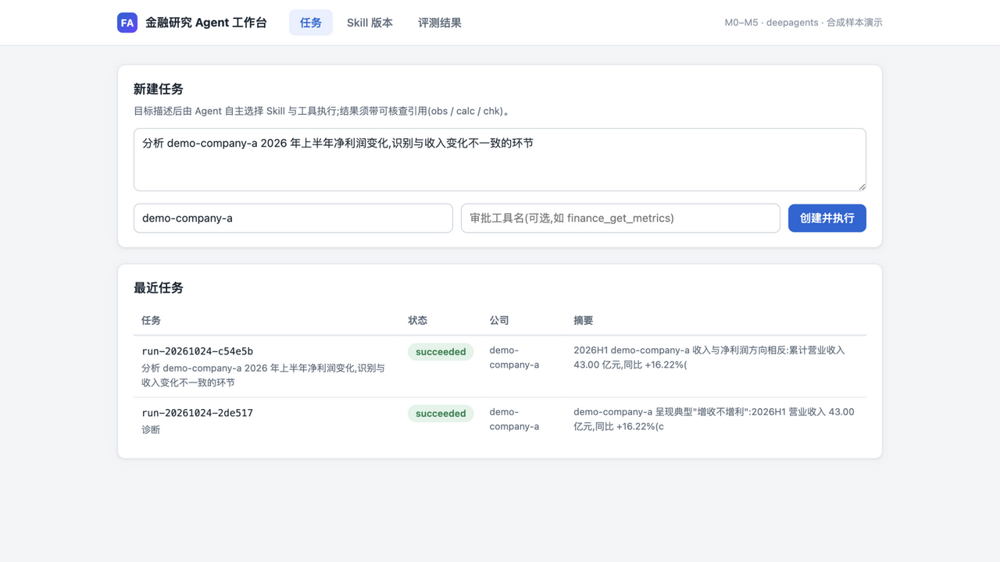
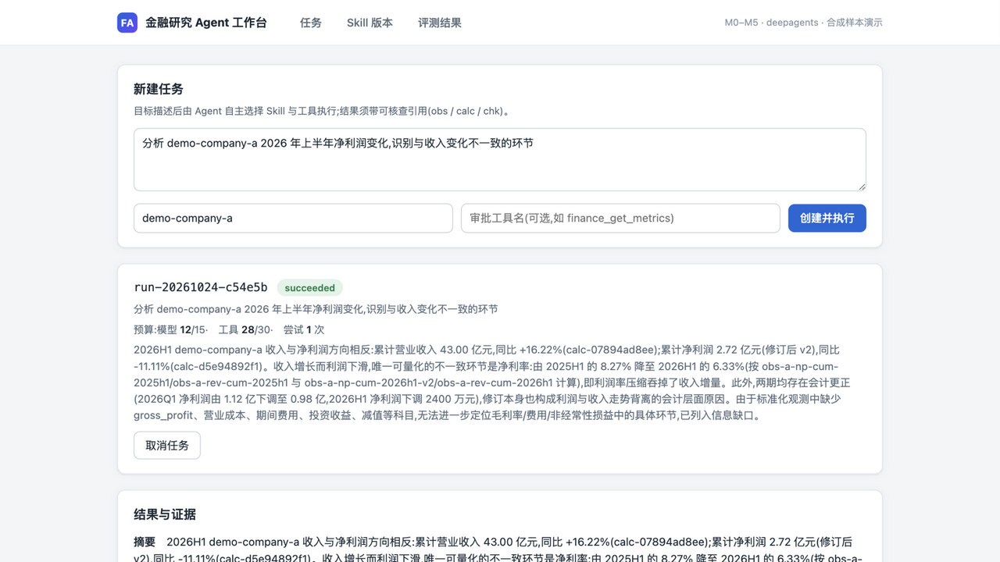
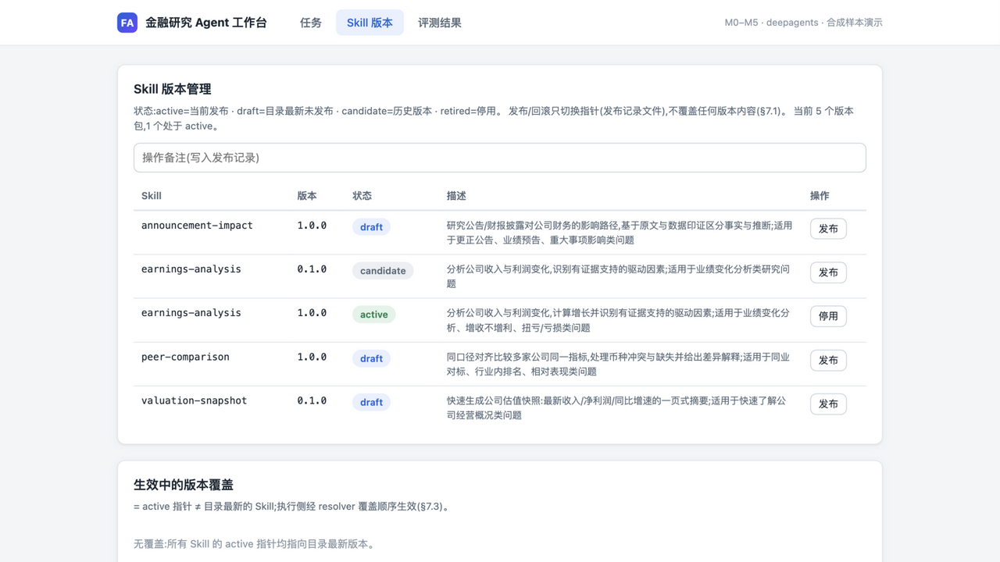
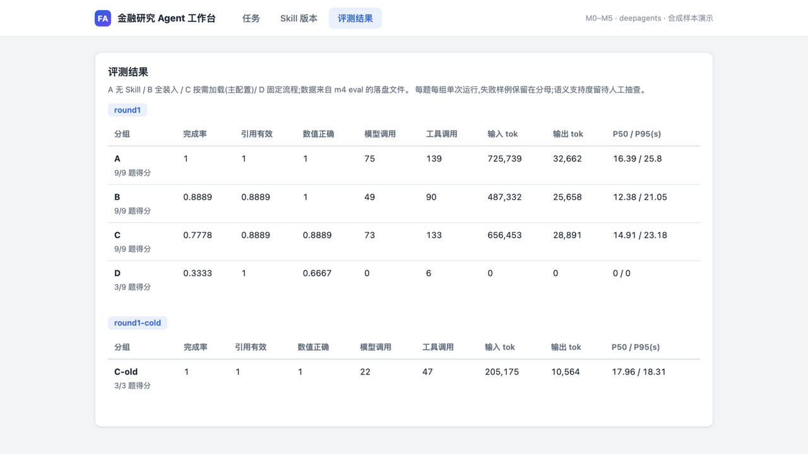

# M5 研究工作台与版本演示

日期:2026-10-24(Asia/Shanghai)
对应设计:§17 M5;退出条件——演示**新增 Skill、数据源切换、任务恢复、版本回滚**,
不依赖手工修改数据库。

## 1. 组成

```text
web/  React 19 + TypeScript + Vite(npm run build 产物 dist/)
  pages/RunPage.tsx     任务输入(目标/公司/审批工具)+ 最近任务列表(GET /v1/runs,
                        点击进入详情)+ 执行时间线(SSE,自动重连 Last-Event-ID)+
                        状态/预算/取消/批准恢复 + 结果与证据渲染
  pages/SkillPage.tsx   版本状态表(active/draft/candidate/retired)+ 发布/停用/
                        回滚(指针切换,不覆盖内容)+ 生效覆盖展示
  pages/EvalPage.tsx    评测结果(A/B/C/D + 版本对照)分组表格
interfaces/api/admin.py  /v1/admin/skills(状态/发布/回滚/停用/zip 导入)、
                        /v1/admin/user-overrides、/v1/admin/evals、/v1/admin/data-source
application/skill_admin.py  发布记录文件(skills/.releases/releases.json)+ 指针推导
```

Skill 版本管理为文件化实现(发布记录 JSON),零数据库改动;执行侧通过
`user_overrides_from_releases` 推导生效版本,与 resolver 的覆盖顺序(任务显式 >
用户 > 项目最新)无缝衔接。

## 2. 本机运行

```bash
uv run fa-db upgrade
uv run uvicorn finance_agent.interfaces.api.app:app --port 8010 &   # API
uv run fa-worker &                                                  # Worker
cd web && npm install && npm run build && npx vite preview --port 5180  # 工作台
# 打开 http://localhost:5180/
```

## 3. 演示脚本(四条退出条件,全部实测通过)

1. **版本回滚**:Skill 版本页 → 发布 earnings-analysis@1.0.0 → 回滚到 0.1.0 →
   页面显示 active 指针切换、生效覆盖变为 `{"earnings-analysis":"0.1.0"}`;
   用该配置跑一次真实任务成功(m2 run,loaded_skills 含 earnings-analysis)。
   再发布 1.0.0 恢复。全程 API/UI 操作,零数据库改动。
2. **新增 Skill**:把 `valuation-snapshot/0.1.0/` 放入 `skills/` →
   `GET /v1/skills` 立即返回 `valuation-snapshot@0.1.0`(available),Skill 版本页
   显示 draft 状态;执行循环代码零修改(§17 M2 条件在 M5 再次成立)。
   zip 上传导入:`POST /v1/admin/skills/import`(name/version/bundle 表单)。
3. **数据源切换**:`FINANCE_AGENT_DATA_SOURCE=akshare` 启动 Worker 即用真实源
   (白酒三家公司);`GET /v1/admin/data-source` 显示当前源与切换说明。
   fixture 与真实源契约一致(见 docs/M4-数据源接入记录.md)。
4. **任务恢复**:任务输入页勾选审批工具(finance_get_metrics)→ 创建 →
   状态 waiting_input 时页面出现"批准并恢复/拒绝"按钮 → 点击批准 → SSE 继续
   推送直至 succeeded。SSE 断开重连由浏览器 EventSource 自动携带
   Last-Event-ID 补读。

## 4. 实测记录(2026-10-24,浏览器 GUI 黑盒)

- 首页/任务详情/Skill 版本/评测结果四页全部渲染正确;真实任务
  run-20261024-c54e5b(12 模型调用/28 工具调用)在 UI 全程可见:SSE 时间线 →
  succeeded → 摘要/发现(fact/inference 分类)/证据(页码段落)/信息缺口。
- 实测发现并修复:
  1. 后端缺 CORS 头(前端跨源 fetch 失败)→ CORSMiddleware 白名单本机端口;
  2. api.ts 展开顺序覆盖 headers(丢失 Content-Type)→ 修复;
  3. FastAPI 路径参数与 body 模型字段同名(version)引发 422 → body 模型去重;
  4. zip 导入改用独立 Form 字段。
- 截图(2026-10-24,浅色渲染):
  
  
  
  

界面为轻量自建设计系统(卡片/徽章/时间线,零 UI 依赖,`web/src/index.css`)。

## 5. 边界与遗留

- vite preview 仅本机演示用途;公网部署需反向代理 + 鉴权(设计 §13.1 首版范围外)
- completed_partial 在 UI 中以状态色区分,但"部分完成"的专门展示留给 M6+
- 评测结果页读取本地 evals/results/(与 API 同机);分布式部署需入库
