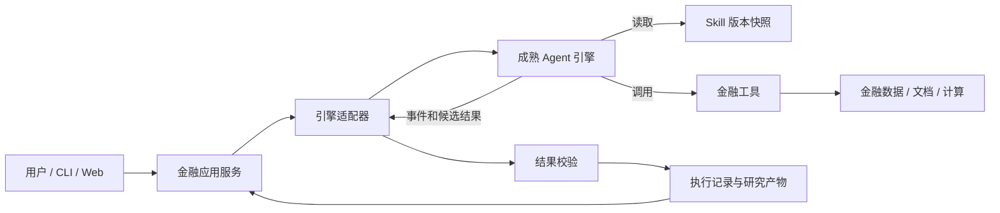
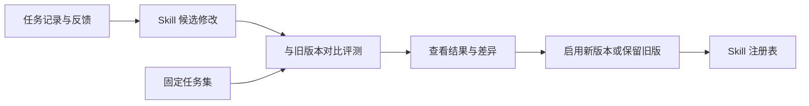

# 金融研究 Agent：系统设计与实施方案

版本：v1.0  
日期：2026-10-23（Asia/Shanghai）  
状态：设计基线，待实施验证  
适用目标：金融 Agent 应用工程、金融科技大模型应用、Agent 平台相关求职作品集。

本文确定系统边界、架构职责、接口契约、实现顺序与验收方法。代码示例为接口草案，不代表已经实现。文中的数量、预算和验收阈值均为首版起点，实际能力与性能以实验记录为准。

## 1. 核心结论

系统采用“金融应用 + 薄引擎适配层 + 成熟 Agent 引擎”的结构。Agent 根据任务和工具结果动态决定调查路径；Skill 提供可选择、可组合的研究经验；工具执行查询、检索和确定性计算；应用负责任务管理、金融数据契约与结果校验。

首选执行底座为 Deep Agents，复用其执行与上下文能力。底层依赖 LangGraph 的具体能力由适配器接入，不另写一套通用执行内核。首版仅接入一个引擎，保留任务边界上的替换接口。是否接入第二个引擎，由后续迁移验证决定。

没有一个要求所有研究问题依次经过相同步骤的固定业务总流程。任务创建、能力检查、执行、结果校验、提交属于应用生命周期；Skill 中的建议步骤与局部确定性子流程，是 Agent 可按需使用的能力。

## 2. 项目目标与范围

### 2.1 目标

1. 用成熟引擎完成开放式金融研究任务，体现动态工具选择与信息补查能力。
2. 将研究方法封装为有版本的 Skill，支持按需加载与个性化覆盖。
3. 将模型、金融数据、检索和计算的变化隔离在明确边界内。
4. 保留任务、工具调用、证据、Skill 版本和结果，支持定位问题与复盘。
5. 通过对比实验验证架构收益，形成面试可以讨论的设计取舍和证据。

### 2.2 首版业务样本

覆盖一个行业、三家公司，提供三类研究任务：业绩变化分析、公告影响研究、同业指标比较。先准备可追溯的公告/财报样本和标准化财务数据，再接入一个真实数据来源。

首批 Skill：`earnings-analysis`、`announcement-impact`、`peer-comparison`。它们共享文档检索、财务数据查询与计算工具。行业选择以开发者熟悉程度和数据可获取性为依据，不在本设计中预设投资方向。

### 2.3 阶段边界

| 首版必须完成 | 后续有需求再做 |
| --- | --- |
| 一个成熟引擎、一套工具契约 | 第二个完整执行引擎 |
| Skill 简介发现、按需加载、版本固定 | 大规模 Skill 语义检索与自动组合优化 |
| 单用户偏好、任务与结果记录 | 多用户隔离和团队管理 |
| 查询、计算、引用校验 | 自动交易和账户操作 |
| 候选 Skill 更新与离线评测 | 无人值守的持续自我修改 |
| 单机 API + Worker + PostgreSQL | 多服务拆分、分布式调度平台 |

## 3. 设计原则与理由

| 决策 | 原因 | 代价与边界 |
| --- | --- | --- |
| 复用成熟 Agent 引擎 | 研发重点在金融能力和经验管理 | 接受框架依赖，升级前做兼容验证 |
| 动态执行 + 可选 Skill | 研究问题的查询路径不固定 | 可能产生多余调用，需要预算与评测 |
| 工具承担确定性计算 | 数值、公式和输入可以核查 | 需维护公式、单位和数据口径 |
| 业务契约独立于框架 | 金融能力与结果可跨引擎复用 | 工作流、检查点和消息不保证通用 |
| Skill 与用户偏好分开 | 方法与个人习惯的适用范围不同 | 需要明确覆盖顺序和任务快照 |
| 模块化单体、独立 Worker | 简化开发，同时让长任务独立于 HTTP 连接 | 初期部署规模有限 |
| 先评测再启用 Skill 新版本 | 单次成功不能证明方法稳定改进 | 需要维护代表性任务集 |

架构独特性来自边界、机制与验证质量，不宣称“插件化”或“Skill”本身是原创发明。

## 4. 系统结构

### 4.1 在线执行关系

下图表示调用关系，不表示节点上下位置对应基础设施层级。Skill 与金融工具是引擎使用的资源；评测不在主请求链路中。



应用准备 Skill 快照和工具集合，通过适配器交给引擎。图中的“引擎调用金融工具”描述运行行为，不代表核心金融模块要导入引擎 SDK。

### 4.2 离线经验更新关系



在线执行中的计划调整不会立即覆盖长期 Skill。新版本先进入候选状态，再由维护者根据评测结果发布。任务恢复继续使用原快照。

### 4.3 部署结构

```text
浏览器 / CLI
     │
FastAPI 进程 ───── PostgreSQL：任务、事件、证据、索引、产物
                        │
独立 Worker ────────────┘
     ├─ 成熟 Agent 引擎 → 模型 API
     ├─ Skill 只读快照
     ├─ 金融工具 → 文档与数据源
     └─ 引擎原生检查点存储

离线评测进程 → 同一应用接口 / 固定数据快照 → 评测报告
```

首版不引入 Redis/Celery。任务表承担轻量队列，Worker 通过短事务领取任务并维护租约。数据库锁不跨模型调用持有。后续并发和调度需求增长，再评估消息队列。

## 5. 模块职责与依赖

| 模块 | 负责 | 不应承担 |
| --- | --- | --- |
| API / CLI | 请求校验、任务接口、SSE 事件输出 | 写研究提示或直接拼 Agent 循环 |
| 应用服务 | 任务、用户偏好、快照、能力匹配、结果提交 | 模拟引擎内部调度 |
| Skill 模块 | 元数据、发现、加载、版本与覆盖 | 把金融事实当研究方法长期保存 |
| 工具模块 | 工具契约、注册、调用约束、结构化错误 | 依赖特定模型的消息对象 |
| 金融能力 | 指标口径、文档检索、计算、证据构造 | 处理 HTTP 或模型供应商协议 |
| 引擎适配 | 构建引擎、挂载 Skill、绑定工具、事件转换、恢复接入 | 承诺所有引擎能力完全一致 |
| 数据适配 | 文档、数据库、财务供应商接口实现 | 决定投资分析路径 |
| 结果校验 | 结构、数值、证据与时间边界检查 | 仅凭引用存在就认定结论正确 |
| 离线评测 | 选择与执行评测、成本比较、版本回归 | 自动把一次成功固化为新规则 |

核心接口和金融能力不导入 `deepagents` 或 `langgraph`。框架导入集中在适配器和启动装配处。数据适配器实现核心定义的接口；应用在启动时注入具体实现。

## 6. Agent 执行形式与生命周期

### 6.1 自主执行的范围

Agent 可选择 Skill、调整调查计划、选择工具、补查证据，以及在信息不足时给出部分结论。系统强制处理预算、工具可用范围、参数校验、数据截止时间和结果提交校验。

Skill 建议“先看收入再看成本”不意味着必须按同样顺序执行；计算工具的公式与数据检查则由代码决定。用户明确要求使用某 Skill 时，记录指定版本和实际加载情况。

### 6.2 一次任务的过程

1. 应用接收目标、公司范围、`as_of`、用户偏好和预算。
2. 解析实体和必要参数；缺少关键条件时进入 `waiting_input`，问题通过任务事件返回。
3. 检查引擎能力，解析可用 Skill 版本，保存任务配置快照。
4. Worker 构建引擎，将候选 Skill 简介和允许工具提供给它。
5. Agent 按需读取 Skill 正文、调用工具、利用返回结果继续调查。
6. 引擎生成候选结构化结果；应用检查数据、计算与引用。
7. 可修复问题最多反馈两轮；修复同样计入预算。仍不满足必需格式则失败，资料不足但结构有效可提交部分结果。
8. 原子提交结果与最终任务状态，提供可追踪事件。

这是通用任务生命周期，不是固定的金融研究步骤。

### 6.3 应用状态机

```text
queued → running → validating → succeeded
             │          └────→ completed_partial
             ├→ waiting_input → queued（带原恢复信息）
             ├→ interrupted   → queued（可恢复时）
             ├→ failed
             └→ cancelled
```

取消请求独立保存为 `cancel_requested_at`。Worker 在模型/工具调用前后检查；外部请求能否立即中断取决于客户端与供应商。超时不代表外部请求未发生，不能因此承诺精确费用或“恰好执行一次”。

`RunContext` 至少固定任务 ID、引擎与适配器版本、模型配置、Skill 解析快照、工具版本、数据快照、预算和用户偏好快照。秘钥不进入上下文和日志。

## 7. Skill 设计

### 7.1 包结构与单一元数据源

```text
skills/earnings-analysis/1.0.0/
  SKILL.md
  references/metric-definitions.md
  templates/report.md
```

以 `SKILL.md` 为包元数据的唯一来源。注册表由其解析生成；发布记录额外保存状态、内容哈希和评测记录。首版 Skill 调用预注册 Python 工具；附带脚本作为经维护者实现的工具发布，不直接开放任意脚本执行。

```yaml
---
name: earnings-analysis
description: 分析公司收入与利润变化，识别有证据支持的驱动因素
metadata:
  app_version: "1.0.0"
  app_required_tools:
    - finance.get_metrics@1
    - documents.search@1
    - finance.calculate_growth@1
  app_optional_tools:
    - finance.get_segments@1
  app_tags: [财报, 利润, 收入]
---
```

`app_*` 为本应用扩展字段，类型由应用解析器定义，不假设任意引擎会原生识别。适配器把它们转换成相应引擎的工具绑定或 Skill 视图。`name`、`description` 与正文采用所选引擎支持的格式。版本必须与内容哈希对应，已发布版本不可原地覆盖。

### 7.2 发现与渐进加载

首版 Skill 少于约 20 个时提供全部合格简介，由 Agent 按需选择。先做必需工具、版本、适用范围筛选，再暴露简介。Skill 较多时增加关键词/向量候选检索，候选数起点为 5，并评测候选召回率。

Agent 未找到合适 Skill 时，可以在现有工具与预算内执行通用研究，记录 `no_skill_selected`，不强行匹配。显式指定的 Skill 不存在或依赖缺失时，返回原因，不静默替换。

加载分三个粒度：简介、正文、引用附件。附件读取按需进行。内容预算起点为输入窗口的 15%，最多同时使用 3 个 Skill 正文；真实阈值按任务实验调整。只读文件视图包含任务允许的包，不暴露整个用户目录。

### 7.3 版本固定与个人覆盖

任务创建时保存允许使用的注册表快照，执行中新增发现仍从这份快照解析。记录候选、选择、加载和实际工具使用，避免只记录“曾出现在提示词中”。

覆盖顺序为：任务显式版本 → 用户已发布覆盖 → 项目已发布版本。注册表先解析唯一版本，再交给引擎，不依赖各引擎不同的同名覆盖行为。

用户偏好保存在独立 Profile，如报告长度、关注指标、语言。公司公告和财务数据保存在证据/数据层。Skill 保存研究方法，不能用修改 Skill 的方式伪造某个公司的事实。

### 7.4 更新过程

状态：`draft → candidate → evaluated → active → retired`。修改产生新版本，附变更原因与影响任务；比较通过后切换 active 指针，回滚同样切换指针。旧版本和运行快照保留。

首版维护者编辑并发布；后续可以让模型生成候选差异，但启用仍依赖可查看的评测报告。Skill 更新不自动覆盖进行中的任务。

## 8. 金融工具与数据契约

### 8.1 ToolSpec

每个工具登记以下字段：`name`、`major_version`、输入/输出 JSON Schema、超时、重试规则、只读属性、幂等特性、处理函数。工具调用由执行端校验，不只依赖模型遵循描述。

首批工具：

| 工具 | 输入 | 输出 |
| --- | --- | --- |
| `documents.search@1` | 查询、公司、时间范围、as_of | 片段、来源、证据 ID |
| `documents.read@1` | 文档版本、定位信息 | 原文与定位 |
| `finance.get_metrics@1` | 公司、指标、报告期、as_of | 标准化财务观测 |
| `finance.calculate_growth@1` | 两个观测 ID | 数值、公式、输入引用或不可计算原因 |
| `finance.compare_peers@1` | 公司集合、同口径指标 | 对齐表与缺失说明 |

### 8.2 依赖检查与绑定

加载前检查必需工具与主版本，缺失时标记该 Skill 不可用。可选工具缺失时保留可执行部分，并记录降级说明。

首版在任务启动时绑定“候选 Skill 所需工具 + 通用基础工具”的受限集合，保证实现简单且执行侧可以校验。若所选版本的引擎支持 Skill 加载时延迟暴露工具，再做动态绑定优化；未加载 Skill 的工具是否可调用，必须与所选策略保持一致。运行中新增工具属于能力扩展，不作为首版必需条件。

工具名在核心中稳定，供应商 API 字段在数据适配器转换。MCP 后续作为外部工具接入方式；普通 Python 函数依然是首版内部工具形态。

### 8.3 标准财务观测

```python
class MetricObservation(BaseModel):
    observation_id: str
    entity_id: str
    metric: str
    value: Decimal | None
    unit: str
    currency: str | None
    period_start: date
    period_end: date
    scope: str                 # 合并/母公司等口径
    available_at: datetime     # 这份版本可公开获知的时间
    retrieved_at: datetime
    source_id: str
    revision_id: str
```

金额使用 Decimal，零和缺失分别表达。单季与累计、合并与母公司、币种与数量单位都要明确。比较前先校验口径；不一致时返回原因，不能默认相加或比较。

同比公式为 `(本期 - 同期) / 同期`，分母为零时返回不可计算；涉及负基数时保留计算值并给出解释限制。计算结果记录输入 ID、公式与版本，不让模型重新生成公式结果。

### 8.4 时间、证据与检索

证据至少保存来源链接、文档版本、内容哈希、页码/段落定位、`available_at` 和抓取时间。工具执行端注入任务 `as_of`，模型参数不得扩大它。修订数据选择截止时间内可获得的版本，而非简单读取最新值。

时间内部统一 UTC，界面按 Asia/Shanghai 展示；仅有日期的来源要记录时间精度和截止策略，不能虚构精确时间。历史样本优先使用正式公开时间；未知时采用保守可用时间并标注。

检索先过滤公司、文档版本与时间范围，再结合关键词和向量。中文首版用分词后 BM25 与 pgvector 合并候选，避免假设 PostgreSQL 默认全文分词已经适配中文。重排作为后续优化。

该机制限制工具侧未来信息访问，但不能消除模型训练数据中的历史知识泄漏，因此历史任务表现不等同于真实预测能力。

### 8.5 结构化错误

统一错误包括 `INVALID_ARGUMENT`、`DATA_NOT_FOUND`、`INCOMPARABLE_METRICS`、`TIMEOUT`、`RATE_LIMITED`、`PROVIDER_ERROR` 和 `BUDGET_EXCEEDED`。错误返回是否可重试、已使用来源及可行替代动作。查询超时可有限退避重试，参数错误和数据缺失不盲目重试。

## 9. 引擎适配设计

### 9.1 统一边界

只统一业务输入、公开事件和产物。规划循环、消息格式、上下文压缩、检查点与子 Agent 由成熟引擎负责。应用用任务快照、工具执行包装器和事件转换补充领域约束，不重复实现其调度系统。

```python
# 接口草案；完整类型由实现阶段补充。
class EngineAdapter(Protocol):
    def capabilities(self) -> EngineCapabilities: ...

    def execute(
        self,
        request: RunRequest,
        bindings: RunBindings,
        control: RunControl,
        resume: ResumeRef | None = None,
    ) -> AsyncIterator[RunEvent]: ...
```

`RunBindings` 包含只读 Skill 快照、经过检查的工具及数据访问对象。`RunControl` 提供截止时间、预算计数与取消信号。`ResumeRef` 是引擎检查点的不透明引用，仅由原适配器解释。适配器输出 `result.proposed`，最终结果由应用校验与提交。

任务查询和取消入口放在 `TaskService`，不让引擎适配器同时承担任务数据库服务。一次任务固定引擎 ID、引擎版本、适配器版本与配置；不支持执行中热切换引擎。

### 9.2 能力协商

能力状态采用 `native / adapted / unsupported`，并附限制与通过的兼容用例。不能因为有对应方法就声明支持，必须实际验证。

| 能力 | 必需性 | 处理方式 |
| --- | --- | --- |
| 模型工具调用 | 必需 | 不支持则拒绝任务 |
| Skill 按需读取 | 必需 | 原生机制或应用侧只读资源工具 |
| 结构化候选结果 | 必需 | 原生输出或解析后有限修复 |
| 运行事件 | 必需 | 至少提供任务、工具和结果阶段事件 |
| 检查点恢复 | M3 必须验证 | 不支持时只能声明重新执行 |
| 动态工具绑定 | 可选 | 降级为启动时绑定候选工具集合 |
| 子 Agent / 并行执行 | 可选 | 首版不依赖 |

Deep Agents 为首选，不把它的具体版本能力预先视为已验证。M0 完成最小兼容实验后锁定 Python、引擎及相关包版本；能力不满足时先调整适配实现，再决定是否更换底座。

### 9.3 Skill 和工具在适配器中的接入

应用先解析用户/项目版本与依赖，生成本次任务可见的只读 Skill 目录或等价资源视图。适配器接入引擎现有 Skill 机制，并把金融工具转换成其要求的调用格式。

应用保留统一工具包装器：检查 task_id、as_of、参数、预算、取消信号和错误，再调用金融能力。供应商秘钥只留在服务端配置。来源文本作为资料传入，不获得修改工具范围、系统约束或 Skill 发布状态的权限。

### 9.4 模型与上下文

首版复用底座已有的模型集成和上下文管理，不另造统一模型 SDK。应用保存 provider、model ID、参数和模板版本，由引擎适配器转换。后续第二个供应商在同一任务集上验证工具调用和结构化结果兼容性。

上下文来源区分系统约束、任务、偏好、Skill 和证据。框架压缩后的上下文不取代完整执行记录。超长工具结果保存为引用，模型按需读取；不能为了缩短上下文而抹掉可核查原始数据。

## 10. 长任务、恢复与预算

### 10.1 任务领取

任务表保存 `lease_owner`、`lease_expires_at`、`attempt` 和 `fencing_token`。Worker 在短事务中使用 `FOR UPDATE SKIP LOCKED` 领取 queued 任务，提交后再执行。运行时定期续租；租约过期后由恢复程序检查并重新排队。

结果写入必须验证当前 fencing token，防止失去租约的旧 Worker 覆盖新执行结果。一次任务允许的重试次数有上限；重试前先确认检查点和版本兼容。

### 10.2 三类记录分开保存

| 记录 | 用途 | 所有者 |
| --- | --- | --- |
| 应用运行记录 | 状态、输入、公开事件、预算、错误 | 应用 |
| 原生检查点 | 引擎内部恢复 | 引擎适配器 |
| 研究产物 | 报告、引用、计算结果、版本 | 金融业务 |

检查点持久化配置与应用数据库可以共用 PostgreSQL 实例，但使用独立表/命名空间。升级前检查兼容性；检查点不可恢复时返回原因，用户可创建新的重跑任务，不伪装成无损恢复。

### 10.3 重复执行和结果提交

首版工具限于查询与纯计算，因此异常恢复后重复调用不会产生交易等外部业务副作用，但可能增加 API 费用。允许在同任务、同参数、同数据版本下缓存结果，缓存命中同样记录事件。

研究产物以 run_id 和 artifact_kind 建立唯一约束；产物、最终状态及对应最终事件在同一事务提交。SSE 断开不终止任务。客户端重复创建请求由 `Idempotency-Key` 和请求摘要判定，同键不同输入返回冲突。

### 10.4 预算起点

开发样例配置：15 次模型调用、30 次工具调用、10 分钟截止时间、2 轮结果修复；这些是待校准参数，不是模型性能承诺。每次模型调用设置最大输出量，在调用前检查预算，调用后记录真实 usage。

Token 与价格可能只能在响应后确认，成本预算是尽力约束，单次调用可能越过剩余额度；记录超额而不宣称绝对精确封顶。恢复沿用已消耗计数，不重置预算。底座内部模型调用也必须纳入回调计数；无法覆盖时明确能力缺口。

## 11. 输出契约与结果校验

`ResearchResult` 至少包含：任务目标、研究时间、公司范围、摘要、关键发现、财务观测引用、计算引用、证据引用、事实/假设/推断类型、信息缺口、Skill 与工具版本、质量标记。

结果分为候选产物与正式产物。校验顺序：

1. JSON Schema 和必需字段。
2. 引用 ID 是否存在于本次允许证据集合，定位与时间是否有效。
3. 计算值是否匹配登记的输入与公式，单位和口径是否一致。
4. 重要判断是否有证据或明确标为假设、信息不足。
5. 对语义支持关系进行模型复核或人工抽查；不能把它包装成确定性真实性证明。

首版关键财务表格由确定性模板从观测和计算对象渲染。正文中的新增数字必须能映射到已有记录，否则标记待复核或要求修复。纯文本中所有数字的语义识别不保证完整覆盖，要在评测中记录漏检。

`completed_partial` 适用于证据不足但结构、已提交数据和引用有效的结果；必需格式无效、已确认的错误数值无法修复时不提交为成功报告。

## 12. 存储与数据模型

| 表/存储 | 核心字段与作用 |
| --- | --- |
| `runs` | 状态、目标、as_of、引擎、配置快照、预算、租约、取消时间 |
| `run_events` | run_id、递增 seq、event_id、类型、payload、时间、attempt |
| `tool_calls` | 调用 ID、工具版本、参数摘要、状态、结果引用、耗时 |
| `skill_versions` | skill_id、版本、范围、内容哈希、路径、状态 |
| `skill_activations` | 项目/用户范围内的 active 指针、发布时间、评测引用 |
| `run_skills` | 候选、选择、加载记录与固定版本 |
| `profiles` | 用户偏好与版本；任务保存引用及快照 |
| `documents` / `document_versions` | 来源、内容哈希、可用时间、解析版本 |
| `chunks` | 文档版本、定位、分词文本、向量 |
| `metric_observations` | 标准财务观测与数据修订版本 |
| `calculations` | 公式版本、输入 ID、参数、结果 |
| `artifacts` | run_id、产物类型、内容引用、质量标记、版本 |
| `eval_cases` / `eval_runs` | 样例、分组、配置快照、评分和原始结果 |
| 本地文件目录 | 原始 PDF、解析文件、Skill 快照、大型工具结果 |
| 引擎专用存储 | 原生检查点，表结构由对应实现管理 |

原始文件和发布后的 Skill 按内容哈希寻址，数据库保存引用。首版本地目录须挂载持久卷；对象存储后续替换。金额列使用 numeric，时间列使用 timestamptz，事件与框架附加信息使用 JSONB。

关键约束包括 `(run_id, seq)` 唯一、Skill 标识/版本/范围唯一、来源版本内容不可覆盖。原始事件以追加为主，状态更新与事件记录采用一致事务。完整工具结果可以是文件引用，不强行全部塞进事件 JSON。

## 13. 对外 API 与事件

### 13.1 接口草案

| 接口 | 用途 |
| --- | --- |
| `POST /v1/runs` | 创建任务，返回 202 与 run_id |
| `GET /v1/runs/{id}` | 状态、配置摘要、错误与产物引用 |
| `GET /v1/runs/{id}/events` | SSE，支持 Last-Event-ID 续读 |
| `POST /v1/runs/{id}/cancel` | 幂等提交取消请求 |
| `POST /v1/runs/{id}/resume` | 在兼容检查后恢复中断或等待输入任务 |
| `GET /v1/runs/{id}/artifacts` | 获取正式结果和证据引用 |
| `GET /v1/skills` | 已发布 Skill 与可用性 |
| `GET /v1/engines` | 引擎与经过验证的能力声明 |

Skill 导入、发布、回滚先通过本地维护命令完成，避免首版增加完整管理后台。API 只返回业务状态，不直接序列化框架检查点。首版仅部署在本机或受控个人环境；开放多用户访问前补充身份与资源归属校验。

### 13.2 任务请求示例

```json
{
  "objective": "分析公司A最近一期收入增长但利润下降的可能原因，并给出证据",
  "entity_ids": ["demo-company-a"],
  "as_of": "2026-10-23T12:00:00+08:00",
  "engine_id": "deepagents",
  "skill_preferences": ["earnings-analysis"],
  "profile_id": "local-default",
  "output_schema": "research-result.v1",
  "budget": {"max_model_calls": 15, "max_tool_calls": 30}
}
```

示例公司与时间仅展示格式，不代表已有真实样本或研究结果。模型、供应商与数据源由已登记配置选择，不接受请求上传秘钥。

### 13.3 公开事件

事件包包含 `event_id`、`run_id`、`seq`、`type`、`occurred_at`、`attempt` 和 `payload`。类型包括任务状态、Skill 选择/加载、工具开始/结束、usage 更新、校验结果、产物提交与错误。

记录可观察的动作与简短计划说明，不依赖模型暴露内部思维过程。SSE 消费者按事件 ID 去重，重连后从数据库补读。接收事件不代表工具只执行过一次。

## 14. 技术栈与选型

| 范围 | 首版选择 | 理由与使用边界 |
| --- | --- | --- |
| 语言与依赖 | Python + uv | 金融数据与 Agent 生态集中；用 uv.lock 固定依赖 |
| 执行引擎 | Deep Agents，使用其底层原生能力 | 与 Skill 按需加载方向匹配；M0 验证后锁版本 |
| HTTP 与结构 | FastAPI + Pydantic | 请求、工具、结果结构一致化 |
| 数据访问 | SQLAlchemy + Alembic + psycopg | 数据模型、迁移与 PostgreSQL 接入 |
| 数据库 | PostgreSQL + pgvector | 结构化记录和向量索引集中存储 |
| 检索 | 中文分词 BM25 + 向量 + RRF | 小样本先验证召回，不提前引入独立搜索集群 |
| 文档解析 | PyMuPDF，按需增加 OCR | 优先处理可复制文本 PDF；扫描件单独评测 |
| 计算 | Decimal、pandas | 金额精度与结构化数据处理 |
| 前端 | React + TypeScript + Vite | 任务输入、执行时间线、结果与证据展示 |
| 后台执行 | Python Worker + PostgreSQL 任务表 | 单机长任务，租约与恢复行为可验证 |
| 日志 | 结构化 JSON + DB 事件 | 首先保证执行记录完整；后续接 OpenTelemetry |
| 测试与评测 | pytest + 离线评测 CLI | 契约、恢复、金融计算与效果对比 |
| 部署 | Docker Compose | API、Worker、数据库与持久卷可复现 |

不在设计文档中把网上最新版本号当兼容保证。M0 固定引擎与模型适配包，保存兼容矩阵及锁文件。数据库、Embedding 模型与向量维度同时固定，迁移时重建对应索引，不混用不同模型的向量。

## 15. 建议代码结构

```text
finance-agent/
  README.md
  pyproject.toml
  uv.lock
  compose.yaml
  .env.example
  docs/
  src/finance_agent/
    contracts/                 # 任务、事件、证据、工具和结果类型
    application/               # RunService、任务快照、结果提交
    skills/                    # 注册、发现、解析、版本和覆盖
    tools/                     # 注册中心、包装器、依赖检查
    finance/                   # 指标、计算、公司标识、证据校验
    retrieval/                 # 切分、关键词和向量检索
    ports/                     # 引擎、数据源、产物存储接口
    adapters/
      engines/deepagents/
      data/                    # fixture 和真实供应商
      persistence/
    interfaces/api/
    interfaces/cli/
    worker/
    bootstrap.py               # 装配具体依赖
  skills/                      # 版本化研究包，与加载器代码分开
  evals/
    cases/dev/
    cases/holdout/
    runners/
    scorers/
  tests/
    contracts/
    finance/
    integration/
  web/
  data/                        # 本地原始文件与快照，按来源管理
```

首次提交代码时增加不含秘钥的配置示例，原始付费数据与个人资料不随意放入仓库。演示优先使用允许分发的样本或清晰标注的合成 fixture。

## 16. 评测与验收方案

### 16.1 数据集

起步准备约 60 个任务：三类任务各 20 个，按公司、报告期间和问题族分组划分开发集与保留集，起点各 30 个。避免同一问题的改写跨集合泄漏。另保留固定的工具错误、缺失数据、时间边界和数值边界用例。

这是作品集规模的初始证据，不代表已证明广泛金融泛化能力。真实文档样本必须记录来源与可用时间，合成样本明确标注。需要人工评分时保存评分规则与标注记录。

### 16.2 四组对照

| 实验组 | 配置 | 目的 |
| --- | --- | --- |
| A | 相同引擎与工具，无领域 Skill | 测量 Skill 的额外贡献 |
| B | 全部 Skill 正文装入上下文 | 与按需加载比较成本及质量 |
| C | 简介发现、按需加载正文 | 本方案主配置 |
| D | 一条代表性任务的固定流程基线 | 检查动态执行的收益与额外成本 |

固定模型、数据快照、工具版本和总调用预算；记录各组实际上下文开销。模型输出有随机性，对关键样例重复运行，报告样本量和分布，不只给一次最佳结果。超时与失败样例保留在分母中。

### 16.3 指标定义

| 指标 | 计算与注意点 |
| --- | --- |
| 候选召回率 | 标注可用 Skill 进入候选的任务比例 |
| 选择合理率 | 选择符合任务的 Skill；允许多个合理答案与无需 Skill |
| 执行质量 | 强制指定正确 Skill 后的结果分数，隔离选择错误 |
| 数值准确率 | 对需要计算的项目核对输入、公式、单位与结果 |
| 引用有效率 | 引用存在、定位可查、时间有效；与语义支持度分别计分 |
| 证据支持度 | 关键结论是否被证据支持；模型评分辅以人工抽查 |
| 任务完成率 | 满足预先标注的任务要求；部分完成单独报告 |
| 时间边界违规 | 工具是否返回截止时间后的资料，标注来源时间精度 |
| 成本与耗时 | Token、工具次数、usage 可得费用、P50/P95 耗时 |
| 恢复正确性 | 可恢复任务的恢复完成率、重复产物和额外调用 |

工具路径不必一致，不能以“调用顺序等于参考顺序”代替质量评测。格式、数值和时间约束用代码评分；开放式研究判断需独立规则、模型辅助和人工检查。

### 16.4 Skill 发布门槛

新版本先通过格式、依赖、路径、金融计算和时间边界用例；已标注的关键错误不得新增。再比较开发集、保留集与相关其他 Skill 的任务，检查收益、退化和成本。

试行门槛为：完成率相对旧版本下降不超过 5 个百分点，且不能新增已知关键错误；若以成本优化为目标，在上述约束下验证调用量改善。该容忍值是维护起点，需结合样本误差调整；效果不明确时保留旧版，不声称改进成立。

每次保存版本差异、配置、逐题结果、失败案例和发布决定。保留集不能在每轮改写时反复用于调参；用尽后补充新的保留样例。

## 17. 实施步骤与阶段产物

按依赖顺序推进，不先开发完整前端。每阶段先达到退出条件，再进入下一阶段。工期由实际可投入时间与数据质量确定，不把预估日期当交付保证。

### M0：底座兼容实验与决策固定

实施：建立最小 Python 工程；接入一个真实模型；让引擎读取一份 Skill、调用一个自定义工具、生成结构化结果；尝试事件输出、预算回调和检查点恢复。

产物：依赖锁文件、可运行 CLI、能力矩阵、选型记录。退出条件：以真实调用确认 Skill 加载、工具执行和结果取得；原生恢复能否满足 M3 有明确结论。此时不建设统一执行内核。

### M1：金融契约与离线工具

实施：定义任务、观测、证据、计算和结果结构；准备三家样本公司与原始文档；实现 fixture 数据源、文档查询和计算工具。

产物：五个核心工具、样本清单、契约和金融边界用例。退出条件：工具可脱离 Agent 单独调用；零分母、缺失值、币种冲突、累计口径、修订时间都有明确行为。

### M2：Skill 注册与首条真实研究任务

实施：编写三个研究包，解析元数据，验证依赖，固定版本，构造只读 Skill 视图；接入引擎适配器，输出引用与计算结果。

产物：可复用研究包、统一 CLI、一次完整执行记录。退出条件：问题可以触发适合的 Skill；不匹配时不强行选择；缺少必需工具时有明确原因；新增一份合格 Skill 不修改执行循环。

### M3：任务服务、持久化与恢复

实施：建表与迁移；实现任务领取、租约、fencing token、原生检查点、预算累计、取消、幂等结果提交和 SSE 补读。

产物：API、Worker、Compose、本机操作说明。退出条件：断开前端不会丢任务；中断 Worker 后可按声明恢复；旧 Worker 不能覆盖结果；重复请求不会产生重复产物；不可恢复场景有真实错误说明。

### M4：数据源替换与评测基线

实施：接入一个真实金融数据源；保持标准观测契约；完成四组实验与 Skill 新旧版本比较。支持样本 fixture 和真实数据适配器切换。

产物：评测 CLI、逐题结果、成本/质量对照表、数据源接入记录。退出条件：所有比较配置可追踪；至少完成一轮真实评测并保留失败案例；不要求实验必须证明方案优于基线。

### M5：研究工作台与版本演示

实施：构建任务输入、执行时间线、结果/证据、Skill 版本和评测结果四个简单页面；支持候选修改、发布记录和回滚。

产物：演示入口、截图、演示脚本、设计与实际实现差异清单。退出条件：演示新增 Skill、数据源切换、任务恢复及版本回滚，不依赖手工修改数据库。

### M6：可选的引擎与模型替换验证

实施：先验证第二个模型供应商；需要证明引擎迁移时，再接入第二个成熟引擎。仅要求任务输入、公开事件与结果契约稳定；各引擎分别实现 Skill/工具接入与能力声明。

产物：适配差异清单、同任务结果对比、复用代码与重写范围说明。退出条件：金融计算和数据适配继续复用；不把重新执行宣称为跨引擎检查点恢复。M6 不阻塞首版作品集完成。

## 18. 关键验收场景

| 场景 | 预期行为 |
| --- | --- |
| 新增一个研究 Skill | 注册后可发现和加载，执行核心无需修改 |
| 用户覆盖项目 Skill | 新任务采用用户已发布版本，旧任务保持原版本 |
| 必需工具缺失 | 加载前发现并返回原因，不让模型猜测工具存在 |
| 模型传入更晚 as_of | 工具执行端拒绝扩大任务截止时间 |
| 财报后来修订 | 历史任务读取当时可获得版本 |
| 数据缺失或口径冲突 | 返回结构化缺口，不填充虚构数值 |
| 超时后重试 | 有限重试，记录次数和成本，预算不归零 |
| HTTP/SSE 断开 | Worker 继续，客户端可续读事件 |
| Worker 中断 | 使用相容检查点恢复，或明确声明只能重跑 |
| Skill 新版退化 | 保留旧 active 版本，记录差异 |
| 引擎能力不匹配 | 创建时拒绝或提供明确的可选降级 |

## 19. 设计取舍与待验证项

1. **动态执行是否更好**：对开放问题有适应空间，但可能更慢、更贵；用固定流程和无 Skill 基线验证。
2. **Skill 是否被正确使用**：进入上下文不代表得到遵循，需记录加载和实际动作，并分别评测选择与执行。
3. **引擎抽象是否合适**：第一版接口只是假设，第二实现才能证明迁移价值；不提前承诺完全替换。
4. **个人化是否导致退化**：偏好与方法分开，用户 Skill 独立版本，保留项目版本回退能力。
5. **历史评测的限制**：工具截止时间可控制，模型已有知识不可完全消除，不能直接推导预测能力或投资收益。
6. **恢复的限制**：原生检查点不自动覆盖外部调用与费用，重复调用、租约和最终提交需应用侧处理。
7. **工程复杂度**：小规模先用本地文件、PostgreSQL 与单 Worker；没有实测瓶颈前不引入图数据库、消息队列或微服务集群。

## 20. 求职展示与设计解释

建议展示四份材料：架构与职责图、一次可核查研究执行、失败恢复演示、Skill/基线对比报告。解释顺序采用“问题 → 备选方案 → 决策 → 代价 → 实验”，不以层数、插件数或角色数量代替设计价值。

可采用的项目定位：

> 使用成熟 Agent 引擎构建金融研究应用，将领域方法封装为按需加载的版本化 Skill，将数据与计算封装为统一工具契约。围绕任务执行、证据与时间边界、版本更新及效果评测实现工程机制，并通过真实任务验证扩展与迁移边界。

上述描述需随实现更新。未实现第二引擎、动态工具绑定或恢复能力时，简历中明确标为预留设计，不写成已完成成果。

## 21. 参考资料与使用边界

查阅日期：2026-10-23。以下仅为公开文档/实现参考，不代表金融机构内部生产架构，也不代表本项目已完成对应能力。版本变化后需重新验证接口。

| 资料 | 本文采用的有限参考 |
| --- | --- |
| [Deep Agents 项目](https://github.com/langchain-ai/deepagents) | 可复用的 Agent 执行底座，提供 Skill、工具与上下文相关能力 |
| [Deep Agents 架构说明](https://github.com/langchain-ai/deepagents/blob/main/libs/ARCHITECTURE.md) | 了解底座模块职责，减少自建重复机制 |
| [Skill 中间件源码](https://github.com/langchain-ai/deepagents/blob/main/libs/deepagents/deepagents/middleware/skills.py) | 渐进式加载和 Skill/工具接入的实现参考；本应用扩展字段不等同其标准接口 |
| [Dexter 架构说明](https://github.com/virattt/dexter/blob/main/AGENTS.md) | 金融研究中的执行循环、模型、工具、Skill 与记录模块划分 |
| [FinRobot](https://github.com/AI4Finance-Foundation/FinRobot) | 金融领域能力与不同 Agent 框架实现的分离思路，不推导运行中无缝替换 |
| [pgvector](https://github.com/pgvector/pgvector) | 在 PostgreSQL 内保存与检索向量；中文关键词检索另行实现 |
| [FastAPI](https://fastapi.tiangolo.com/) | API 实现参考 |


